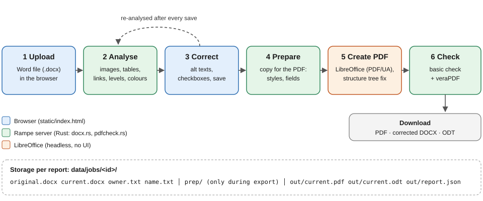
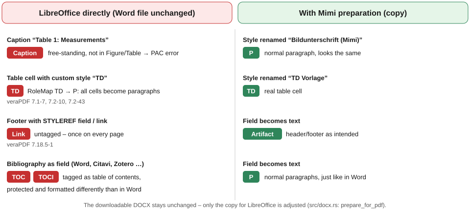

# How Leo works

*Leo – Leichte Erstellung Ohne Barrieren*

[Deutsch](FUNCTION.md) · **English**

Leo turns a Word report (.docx) into an accessible PDF according to **PDF/UA-1**.
Staff upload the report in the browser, add what only a human can know (e.g. alt texts)
and get a checked PDF back.

Installation and operation: [INSTALL.en.md](INSTALL.en.md) · Usage and settings: [README.en.md](README.en.md) · User guide: [INSTRUCTION.en.md](INSTRUCTION.en.md)

## Workflow



| Step | Where | What happens |
|---|---|---|
| 1 Upload | Browser → `POST /api/upload` | The file is stored as `original.docx` and `current.docx`. |
| 2 Analyse | `docx::analyze` | Images, tables, links, headings, colours, title and language are read and sent to the browser as a list of findings. |
| 3 Correct | Browser → `POST /api/job/{id}/apply` | The changes are written into `current.docx` with `docx::apply`. The file is then re-analysed immediately. If it can no longer be read, nothing is saved. |
| 4 Prepare | `docx::prepare_for_pdf` | For the export a **copy** is made with adjustments that only concern LibreOffice (see below). |
| 5 Create PDF | headless LibreOffice, then `pdffix::fix_structure` | The copy is turned into `out/current.pdf` (PDF/UA, tagged) and `out/current.odt`. Leo then fixes the PDF's structure tree (see [Post-processing](#post-processing-of-the-pdf)). |
| 6 Check | `pdfcheck::basic_checks` + veraPDF | Basic check and, if installed, the full PDF/UA-1 validation. The result is stored in `out/report.json`. |

The downloadable DOCX is always `current.docx`, i.e. the version with the corrections from
step 3 and without the adjustments from step 4. It remains a normal Word file.

## Building blocks

| File | Purpose |
|---|---|
| `src/main.rs` | Web server (axum): routes, login, storage, calling LibreOffice |
| `src/cleanup.rs` | Automatic deletion of reports |
| `src/audit.rs` | Audit log for admins |
| `src/totp.rs` | Two-factor login (TOTP, QR code) |
| `src/auth.rs` | Users, passwords (Argon2id), sessions, command-line commands |
| `src/docx.rs` | Reading, correcting and preparing the Word file |
| `src/pdffix.rs` | Post-processing of the PDF: straightening incorrectly nested structure |
| `src/formula.rs` | Equations: find them, linear format, store own alt texts |
| `src/pdfcheck.rs` | Basic check of the PDF, calling veraPDF |
| `static/index.html` | The entire user interface (one page, no external dependencies) |
| `static/admin.html` | User management |
| `static/audit.html` | Audit log page |
| `static/menu.css`, `static/menu.js` | shared top bar of all pages: navigation, user menu |
| `deploy/` | Deploy script, systemd service, nginx configuration |

### How the Word file is edited

A DOCX is a ZIP archive of XML files (`word/document.xml`, `word/styles.xml`,
headers and footers …). Leo reads the XML **event-based** (quick-xml) and passes
everything through unchanged. Only the elements that actually change are rewritten.
All other ZIP entries are copied raw without repacking. This way everything Leo does not
understand (charts, macros, Word extensions) is preserved byte for byte.

## What is checked and corrected

| Area | Detection | Correction in Leo |
|---|---|---|
| Images, shapes, charts | missing or meaningless alt text (“Bild 3”, file name) | enter text, use the caption, or “decorative” |
| Equations (`m:oMath`) | need an alt text in the PDF (veraPDF 7.7-1) | linear format as suggestion or own text → `docProps/custom.xml`, on export `Alt` on the `Formula` element |
| Tables | first row not marked as header row | checkbox → `w:tblHeader` |
| Document | title and main language missing | fields → `docProps/core.xml`, default language in `styles.xml` |
| Links | link without ScreenTip (mainly in tables of contents) | ScreenTip from the link text. LibreOffice turns it into the link description `/Contents` |
| Headings | skipped level (H4 after H2) | apply the style of the correct level |
| Font colours | contrast below 4.5 : 1 against white | darken the shade until 4.6 : 1 is reached |
| Structure | no headings, bold instead of heading, typed lists, empty paragraphs | hint only, fix in Word |

## Preparation for LibreOffice

LibreOffice creates the PDF. A few quirks when converting Word files would, however, lead to
PDF/UA errors even if the Word document itself is fine. Leo fixes them in a copy that is
made only for the export:



| Adjustment | Why | Function |
|---|---|---|
| Custom styles named after a standard PDF tag (e.g. “TD”, “Quote”) get the suffix “Vorlage” | LibreOffice turns every style name into a tag and maps it via RoleMap. A style “TD” would thus turn **all** table cells into paragraphs (veraPDF 7.1-7, 7.2-10, 7.2-43). | `rename_std_styles` |
| The style “Beschriftung” (`caption`) is called “Bildunterschrift (Leo)” in the copy | LibreOffice tags captions as `Caption`, but free-standing instead of inside `Figure`/`Table`. PAC complains about that. As a normal paragraph it is correct. Numbering (SEQ fields) and indexes stay the same. | `rename_caption_style` |
| Links and reference fields (`STYLEREF`, `REF`, `PAGEREF` …) in headers and footers become text | Headers and footers are artifacts in the PDF. A link inside them is untagged – on every page (veraPDF 7.18.5-1). | `unlink_header_footer` |
| Bibliography fields (Word `BIBLIOGRAPHY`, Citavi, Zotero, EndNote) become text | Otherwise LibreOffice builds a protected index that looks different from Word and is tagged as a table of contents (`TOC`). | `unlink_bibliography` |
| Paragraph spacing from the table style is written directly onto the cell paragraphs, unless the paragraph style (other than “Standard”) or direct formatting sets it | That is how Word calculates it. LibreOffice uses the document defaults instead (e.g. line spacing 1.25 instead of 1.1 from “Table Grid”). The rows get taller. In the Praxistest report: 65 instead of 57 pages. Conditional formats (first row etc.) are not taken into account. | `apply_table_spacing` |
| Links to local files (`file://`, `C:\…`, `\\server\…`) become text | They lead nowhere in the PDF. Leo also reports them in the analysis. | `unlink_local` |
| Images and shapes in headers/footers become decorative, with alt text `rampe:dekorativ` | Headers/footers are artifacts, but LibreOffice tags anchored graphics in them as `Figure` (PAC: “Possibly inappropriate use of a Figure”). For images the Word “decorative” mark is enough. LibreOffice still tags shapes (decorative bars); post-processing recognises them by their alt text. The same applies to shapes marked as decorative in the body text. | `decorate_all`, `mark_decorative_alt` |

Which adjustments a report gets is shown by Leo before export in the tab
“PDF erzeugen” (`pdf_prep` in the analysis).

## Post-processing of the PDF

LibreOffice places Word **frames** (`w:framePr`, e.g. title block on page 1, imprint,
address block) and text boxes in the PDF as a `Div` **inside the paragraph they are
anchored to**:

```
before                               after
Document                             Document
├─ Logo paragraph (P)                ├─ Logo paragraph (P)
├─ Block (P)                         ├─ Block (P)
│   ├─ Figure, Figure                │   └─ Figure, Figure
│   └─ Div            ✗              ├─ Div                ✓
│       ├─ Title (P)                 │   ├─ Title (P)
│       └─ Subtitle (P)              │   └─ Subtitle (P)
```

A paragraph must not contain divisions, paragraphs or headings (ISO 32000-2 Annex L).
PDF/UA-1 and veraPDF do not check this, PDF/UA-2 and PAC do.

Restructuring the Word file (dissolving frames) would change the layout. In particular,
“anchored at the bottom of the page” cannot be reproduced with normal text. So Leo
corrects the finished PDF instead: every block element inside a paragraph is moved one level
up, directly after that paragraph. A paragraph that becomes empty as a result is removed.
Only parent references in the structure tree are changed. Page content, content mapping
(MCID) and layout remain untouched.

**Decorative shapes:** LibreOffice only takes over the Word “decorative” mark for images.
Shapes (rectangles, decorative bars) are tagged as `Figure`. The export copy gives them the
alt text `rampe:dekorativ`. Post-processing turns their marked content into
`/Artifact BMC`, clears the entry in the ParentTree and removes the structure element
(`artifact_decorative`). The page image stays the same.

**Equations:** LibreOffice tags Word equations as `Formula`, but without alt text. Word has no
field for it. Leo generates the linear format (as Word shows it under “Linear”, e.g.
`E=mc^2`) and suggests it. An own text is stored as a custom document property
`Leo-Formel-<checksum of the linear format>` in `docProps/custom.xml`. It is kept by Word and
LibreOffice; if the equation changes, Leo asks again. Post-processing sets the texts in order
as `Alt` on the `Formula` elements (body, then footnotes, then endnotes; `set_formula_alts`).
If the number of equations in Word and PDF does not match, it sets no text and reports this in
the check report. Better a message than a wrongly assigned text.

**Independent of LibreOffice versions:** The correction looks for the rule (“block element
in paragraph”), not for a particular LibreOffice pattern. If a later version builds the tree
correctly itself, it finds nothing and leaves the PDF unchanged. If it gets it wrong in a
different way, the basic check reports “Falsch verschachtelte Struktur” (incorrectly nested
structure). So an error is never passed through silently. After a LibreOffice update the
regression test (see [Testing](#testing)) shows whether everything still works.

## Audit log and two-factor login

**Audit log** (`audit.rs`): one JSON line per event in `audit.log`, append-only, mode 600.
It records time, user (or “Kommandozeile”/command line or “System”), action, affected user or
report ID, success, extra info and IP address (from the reverse proxy, `X-Forwarded-For`). File
names and contents of reports are deliberately not included. Input from outside is shortened
and stripped of control characters so nobody can fake lines. Entries older than `AUDIT_DAYS`
(90) are removed by the hourly cleanup.

**Two-factor** (`totp.rs`, `auth.rs`): TOTP according to RFC 6238 (HMAC-SHA1, 6 digits,
30 seconds, one time step tolerance). The secret (160 bits, Base32) is stored as `:totp=…` in
`users.txt`. Setup: Leo generates a secret and shows it as a QR code; it is only stored once the
first code from the app is correct (an open setup expires after 10 minutes). At login Leo first
checks the password, then the code. A code is valid only once (last time step per user). A
wrong code counts as a failed attempt for the lockout.

## Automatic deletion

The user interface only ever shows the report last worked on. Older reports could not be
opened by the user anyway. Therefore (`cleanup.rs`):

| Case | deleted after |
|---|---|
| a user's report last worked on | `JOB_TTL_DAYS` days without use (default 30) |
| older reports of the same user | 1 day without use (buffer for two browser tabs) |
| leftovers of aborted uploads (no `owner.txt`) | 1 day |
| all reports of a user | immediately when the user is deleted |
| a single report | immediately with “Bericht jetzt löschen” (`DELETE /api/job/{id}`) |

Use means any access to the report (open, save, export, download). Leo writes the time to
`last_used`. A report that is being exported is never deleted. Leo cleans up at start and then
hourly. `JOB_TTL_DAYS=0` turns deletion off.

## Checking the PDF

1. **Basic check** (`pdfcheck.rs`, always): tagged, language, title and its display,
   PDF/UA identifier, remapped standard tags, alt texts, headings and level jumps,
   nesting (block elements in paragraphs), table headers, embedded fonts, link
   descriptions, untagged links.
2. **veraPDF** (if installed): complete automated validation against PDF/UA-1.

What no software can check, e.g. whether an alt text makes sense or whether the reading
order is right, remains with a human. The final test with **PAC** (Windows only) is done by
the staff member.

## Field test: Praxistest final report (November 2026)

100 pages, 64 images, 12 tables, 113 links in the indexes. Checked with veraPDF 1.30.4 (PDF/UA-1):

| | Word file directly | preparation only | preparation + corrections in Leo |
|---|---|---|---|
| Style “TD” remapped (7.1-7, 7.2-10, 7.2-43) | ✗ | ✓ | ✓ |
| Links in footers (7.18.5-1) | ✗ | ✓ | ✓ |
| 37 images without alt text (7.3-1) | ✗ | ✗ | ✓ |
| 169 links without description (7.18.1-2, 7.18.5-2) | ✗ | ✗ | ✓ |
| 4 skipped heading levels (7.4.2-1) | ✗ | ✗ | ✓ |
| **Result** | 8 rules violated | 4 rules violated | **compliant** |

All 111 index entries (contents, tables, figures) are linked in the PDF.
The 63 captions are normal paragraphs instead of free-standing `Caption`.

Nesting rules (veraPDF, PDF/UA-2 profile, table 5), before and after post-processing:

| Rule | before | after |
|---|---|---|
| `P` contains `Div` (title block, imprint, address block) | 3 | 0 |
| `P` contains `P` (paragraphs in these frames) | 18 | 0 |
| `P` contains heading (“Impressum”) | 1 | 0 |

Text and page image are identical before and after post-processing.
The text was compared with `pdftotext` and pages 1, 2, 50 and 100 pixel by pixel.

## Testing

```bash
cargo test --release                     # unit tests of the XML transformations
cargo test --release -- --ignored        # additionally with LibreOffice (regression test)
```

The regression test `libreoffice_roundtrip` runs a built-in sample document
(caption, TD style, bibliography, frame) through preparation, LibreOffice and
post-processing. Afterwards the basic check must be clean. **Run it after every
LibreOffice update.** Ideally in the container with the version installed there, or locally
with the same version.

Post-process and check an existing PDF (writes `a.fixed.pdf` next to it):

```bash
RAMPE_TEST_PDF=a.pdf cargo test --release fix_file -- --ignored --nocapture
```

Run a real report without the user interface: with `RAMPE_TEST_APPLY=1` everything you can
click in Leo is applied first. Alt texts become placeholders.

```bash
RAMPE_TEST_APPLY=1 RAMPE_TEST_IN=bericht.docx RAMPE_TEST_OUT=/tmp/rt \
  cargo test --release write_fixture -- --ignored --nocapture

cd /tmp/rt
soffice --headless --convert-to 'pdf:writer_pdf_Export:{"UseTaggedPDF":{"type":"boolean","value":"true"},"PDFUACompliance":{"type":"boolean","value":"true"}}' vorbereitet.docx
verapdf -f ua1 --format text vorbereitet.pdf
```

Without `RAMPE_TEST_IN` a small built-in sample document is used.

## Open issues

- **Row heights in tables**: spacing from table styles is compensated by the preparation
  (see above). If differences remain, it is usually due to missing fonts (see
  [INSTALL.en.md](INSTALL.en.md#fonts)). Fixed row heights cut off multi-line cells and are
  therefore not a solution.
- Further limitations of the prototype: see [README.en.md](README.en.md#known-limitations-of-the-prototype).
