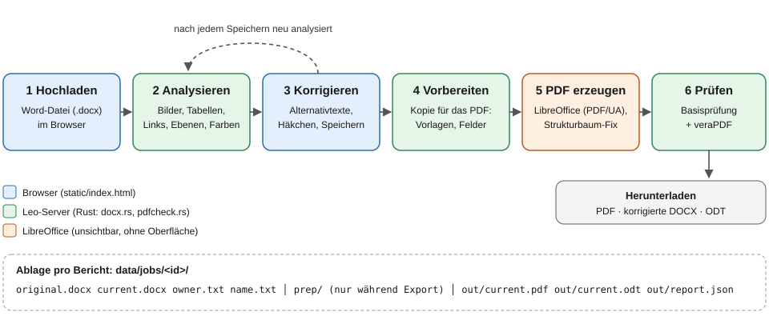
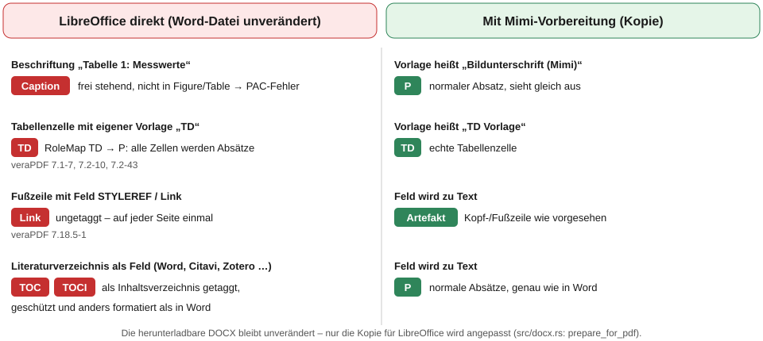

# Wie Leo funktioniert

*Leo – Leichte Erstellung Ohne Barrieren*

**Deutsch** · [English](FUNCTION.en.md)

Leo macht aus einem Word-Bericht (.docx) ein barrierefreies PDF nach **PDF/UA-1**.
Die Mitarbeitenden laden den Bericht im Browser hoch, ergänzen dort, was nur ein Mensch
wissen kann (z. B. Alternativtexte), und bekommen ein geprüftes PDF zurück.

Installation und Betrieb: [INSTALL.md](INSTALL.md) · Bedienung und Einstellungen: [README.md](README.md)

## Ablauf



| Schritt | Wo | Was passiert |
|---|---|---|
| 1 Hochladen | Browser → `POST /api/upload` | Die Datei wird als `original.docx` und `current.docx` abgelegt. |
| 2 Analysieren | `docx::analyze` | Bilder, Tabellen, Links, Überschriften, Farben, Titel und Sprache werden gelesen und als Liste von Befunden an den Browser geschickt. |
| 3 Korrigieren | Browser → `POST /api/job/{id}/apply` | Die Änderungen werden mit `docx::apply` in `current.docx` geschrieben. Danach wird die Datei sofort neu analysiert. Ist sie nicht mehr lesbar, wird nicht gespeichert. |
| 4 Vorbereiten | `docx::prepare_for_pdf` | Für den Export entsteht eine **Kopie** mit Anpassungen, die nur LibreOffice betreffen (siehe unten). |
| 5 PDF erzeugen | LibreOffice ohne Oberfläche, danach `pdffix::fix_structure` | Aus der Kopie entstehen `out/current.pdf` (PDF/UA, getaggt) und `out/current.odt`. Anschließend richtet Leo den Strukturbaum des PDFs (siehe [Nachbearbeitung](#nachbearbeitung-des-pdfs)). |
| 6 Prüfen | `pdfcheck::basic_checks` + veraPDF | Basisprüfung und, falls installiert, die vollständige PDF/UA-1-Prüfung. Das Ergebnis liegt in `out/report.json`. |

Die herunterladbare DOCX ist immer `current.docx`, also die Fassung mit den Korrekturen aus
Schritt 3 und ohne die Anpassungen aus Schritt 4. Sie bleibt eine normale Word-Datei.

## Bausteine

| Datei | Aufgabe |
|---|---|
| `src/main.rs` | Webserver (axum): Routen, Anmeldung, Ablage, Aufruf von LibreOffice |
| `src/auth.rs` | Benutzer, Passwörter (Argon2id), Sitzungen, Kommandozeilenbefehle |
| `src/docx.rs` | Lesen, Korrigieren und Vorbereiten der Word-Datei |
| `src/pdffix.rs` | Nachbearbeitung des PDFs: falsch verschachtelte Struktur geradeziehen |
| `src/pdfcheck.rs` | Basisprüfung des PDFs, Aufruf von veraPDF |
| `static/index.html` | Die gesamte Oberfläche (eine Seite, ohne externe Abhängigkeiten) |
| `static/admin.html` | Benutzerverwaltung |
| `deploy/` | Deploy-Skript, systemd-Dienst, nginx-Konfiguration |

### Wie die Word-Datei bearbeitet wird

Eine DOCX ist ein ZIP-Archiv mit XML-Dateien (`word/document.xml`, `word/styles.xml`,
Kopf- und Fußzeilen …). Leo liest das XML **ereignisbasiert** (quick-xml) und reicht alles
unverändert durch. Neu geschrieben werden nur die Elemente, die sich tatsächlich ändern.
Alle anderen ZIP-Einträge werden roh kopiert, ohne sie neu zu packen. So bleibt alles,
was Leo nicht versteht (Diagramme, Makros, Erweiterungen von Word), Byte für Byte erhalten.

## Was geprüft und korrigiert wird

| Bereich | Erkennung | Korrektur in Leo |
|---|---|---|
| Bilder, Formen, Diagramme | fehlender oder nichtssagender Alternativtext („Bild 3“, Dateiname) | Text eingeben, Bildunterschrift übernehmen oder „dekorativ“ |
| Tabellen | erste Zeile nicht als Kopfzeile markiert | Häkchen → `w:tblHeader` |
| Dokument | Titel und Hauptsprache fehlen | Felder → `docProps/core.xml`, Standardsprache in `styles.xml` |
| Links | Link ohne QuickInfo (v. a. in Verzeichnissen) | QuickInfo aus dem Linktext. LibreOffice macht daraus die Linkbeschreibung `/Contents` |
| Überschriften | übersprungene Ebene (H4 nach H2) | Vorlage der richtigen Ebene setzen |
| Schriftfarben | Kontrast unter 4,5 : 1 gegen Weiß | Farbton abdunkeln, bis 4,6 : 1 erreicht ist |
| Struktur | keine Überschriften, fett statt Überschrift, getippte Aufzählungen, Leerabsätze | nur Hinweis, in Word beheben |

## Vorbereitung für LibreOffice

LibreOffice erzeugt das PDF. Ein paar Eigenheiten beim Umwandeln von Word-Dateien würden
aber zu PDF/UA-Fehlern führen, auch wenn das Word-Dokument selbst in Ordnung ist. Leo
behebt sie in einer Kopie, die nur für den Export entsteht:



| Anpassung | Warum | Funktion |
|---|---|---|
| Eigene Vorlagen mit dem Namen eines PDF-Standard-Tags (z. B. „TD“, „Quote“) bekommen den Zusatz „Vorlage“ | LibreOffice macht aus jedem Vorlagennamen einen Tag und leitet ihn per RoleMap um. Eine Vorlage „TD“ würde so **alle** Tabellenzellen zu Absätzen machen (veraPDF 7.1-7, 7.2-10, 7.2-43). | `rename_std_styles` |
| Die Vorlage „Beschriftung“ (`caption`) heißt in der Kopie „Bildunterschrift (Leo)“ | LibreOffice taggt Beschriftungen als `Caption`, aber frei stehend statt innerhalb von `Figure`/`Table`. PAC bemängelt das. Als normaler Absatz ist es korrekt. Nummerierung (SEQ-Felder) und Verzeichnisse bleiben gleich. | `rename_caption_style` |
| Links und Verweis-Felder (`STYLEREF`, `REF`, `PAGEREF` …) in Kopf- und Fußzeilen werden zu Text | Kopf- und Fußzeilen sind im PDF Artefakte. Ein Link darin ist ungetaggt, und zwar auf jeder Seite (veraPDF 7.18.5-1). | `unlink_header_footer` |
| Literaturverzeichnis-Felder (Word `BIBLIOGRAPHY`, Citavi, Zotero, EndNote) werden zu Text | LibreOffice baut sonst ein geschütztes Verzeichnis, das anders aussieht als in Word und als Inhaltsverzeichnis (`TOC`) getaggt wird. | `unlink_bibliography` |
| Absatzabstände der Tabellenvorlage werden direkt an die Zellabsätze geschrieben, soweit Absatzvorlage (außer „Standard“) oder direkte Formatierung sie nicht festlegen | So rechnet Word. LibreOffice nimmt stattdessen die Dokument-Standardwerte (z. B. Zeilenabstand 1,25 statt 1,1 aus „Tabellenraster“). Die Zeilen werden höher. Beim Praxistest-Bericht: 65 statt 57 Seiten. Bedingte Formate (erste Zeile usw.) werden nicht berücksichtigt. | `apply_table_spacing` |
| Links auf lokale Dateien (`file://`, `C:\…`, `\\server\…`) werden zu Text | Sie führen im PDF ins Leere. Leo meldet sie auch in der Analyse. | `unlink_local` |
| Bilder und Formen in Kopf-/Fußzeilen werden dekorativ, mit Alternativtext `rampe:dekorativ` | Kopf-/Fußzeilen sind Artefakte, verankerte Grafiken darin taggt LibreOffice aber als `Figure` (PAC: „Possibly inappropriate use of a Figure“). Bei Bildern genügt die Word-Markierung „dekorativ“. Formen (Zierbalken) taggt LibreOffice trotzdem; die Nachbearbeitung erkennt sie am Alternativtext. Dasselbe gilt für Formen, die im Text als dekorativ markiert sind. | `decorate_all`, `mark_decorative_alt` |

Welche Anpassungen ein Bericht bekommt, zeigt Leo vor dem Export im Reiter
„PDF erzeugen“ an (`pdf_prep` in der Analyse).

## Nachbearbeitung des PDFs

Word-**Rahmen** (`w:framePr`, z. B. Titelblock auf Seite 1, Impressum, Adressblock) und
Textfelder setzt LibreOffice im PDF als `Div` **in den Absatz, an dem sie verankert sind**:

```
vorher                               nachher
Document                             Document
├─ Logo-Absatz (P)                   ├─ Logo-Absatz (P)
├─ Block (P)                         ├─ Block (P)
│   ├─ Figure, Figure                │   └─ Figure, Figure
│   └─ Div            ✗              ├─ Div                ✓
│       ├─ Title (P)                 │   ├─ Title (P)
│       └─ Subtitle (P)              │   └─ Subtitle (P)
```

Ein Absatz darf keine Bereiche, Absätze oder Überschriften enthalten (ISO 32000-2 Anhang L).
PDF/UA-1 und veraPDF prüfen das nicht, PDF/UA-2 und PAC schon.

Ein Umbau der Word-Datei (Rahmen auflösen) würde das Layout verändern. Vor allem
„unten an der Seite verankert“ lässt sich mit normalem Text nicht nachbauen. Deshalb
korrigiert Leo stattdessen das fertige PDF: Jedes Blockelement, das in einem Absatz
steckt, wird eine Ebene höher direkt hinter diesen Absatz gehängt. Ein dadurch leerer Absatz
fällt weg. Geändert werden nur Eltern-Verweise im Strukturbaum. Seiteninhalt, Zuordnung
der Inhalte (MCID) und Layout bleiben unberührt.

**Dekorative Formen:** LibreOffice übernimmt die Word-Markierung „dekorativ“ nur bei Bildern.
Formen (Rechtecke, Zierbalken) werden als `Figure` getaggt. Die Export-Kopie gibt ihnen den
Alternativtext `rampe:dekorativ`. Die Nachbearbeitung macht aus ihrem markierten Inhalt
`/Artifact BMC`, leert den Eintrag im ParentTree und entfernt das Strukturelement
(`artifact_decorative`). Das Seitenbild bleibt gleich.

**Unabhängig von LibreOffice-Versionen:** Die Korrektur sucht nach der Regel („Blockelement
in Absatz“), nicht nach einem bestimmten Muster von LibreOffice. Macht eine spätere Version
den Baum selbst richtig, findet sie nichts und lässt das PDF unverändert. Macht sie es
anders falsch, meldet die Basisprüfung „Falsch verschachtelte Struktur“. Ein Fehler wird
also nie still durchgereicht. Nach einem LibreOffice-Update zeigt der Regressionstest
(siehe [Testen](#testen)), ob alles noch passt.

## Prüfung des PDFs

1. **Basisprüfung** (`pdfcheck.rs`, immer): getaggt, Sprache, Titel und dessen Anzeige,
   PDF/UA-Kennung, umgeleitete Standard-Tags, Alternativtexte, Überschriften und
   Ebenensprünge, Verschachtelung (Blockelemente in Absätzen), Tabellenköpfe,
   eingebettete Schriften, Linkbeschreibungen, ungetaggte Links.
2. **veraPDF** (falls installiert): vollständige maschinelle Prüfung nach PDF/UA-1.

Was keine Software prüfen kann, z. B. ob ein Alternativtext sinnvoll ist oder ob die
Lesereihenfolge stimmt, bleibt beim Menschen. Den abschließenden Test mit **PAC** (nur Windows)
macht die Mitarbeiterin bzw. der Mitarbeiter.

## Praxistest: Praxistest-Abschlussbericht (November 2026)

100 Seiten, 64 Bilder, 12 Tabellen, 113 Links in den Verzeichnissen. Prüfung mit veraPDF 1.30.4 (PDF/UA-1):

| | Word-Datei direkt | nur Vorbereitung | Vorbereitung + Korrekturen in Leo |
|---|---|---|---|
| Vorlage „TD“ umgeleitet (7.1-7, 7.2-10, 7.2-43) | ✗ | ✓ | ✓ |
| Links in Fußzeilen (7.18.5-1) | ✗ | ✓ | ✓ |
| 37 Bilder ohne Alternativtext (7.3-1) | ✗ | ✗ | ✓ |
| 169 Links ohne Beschreibung (7.18.1-2, 7.18.5-2) | ✗ | ✗ | ✓ |
| 4 übersprungene Überschriftenebenen (7.4.2-1) | ✗ | ✗ | ✓ |
| **Ergebnis** | 8 Regeln verletzt | 4 Regeln verletzt | **konform** |

Alle 111 Verzeichniseinträge (Inhalt, Tabellen, Abbildungen) sind im PDF verlinkt.
Die 63 Beschriftungen sind normale Absätze statt frei stehender `Caption`.

Verschachtelungsregeln (veraPDF, Profil PDF/UA-2, Tabelle 5), vor und nach der Nachbearbeitung:

| Regel | vorher | nachher |
|---|---|---|
| `P` enthält `Div` (Titelblock, Impressum, Adressblock) | 3 | 0 |
| `P` enthält `P` (Absätze in diesen Rahmen) | 18 | 0 |
| `P` enthält Überschrift („Impressum“) | 1 | 0 |

Text und Seitenbild sind vor und nach der Nachbearbeitung identisch.
Geprüft wurden der Text mit `pdftotext` und die Seiten 1, 2, 50 und 100 pixelgenau.

## Testen

```bash
cargo test --release                     # Unit-Tests der XML-Umbauten
cargo test --release -- --ignored        # zusätzlich mit LibreOffice (Regressionstest)
```

Der Regressionstest `libreoffice_roundtrip` jagt ein eingebautes Beispieldokument
(Beschriftung, TD-Vorlage, Literaturverzeichnis, Rahmen) durch Vorbereitung, LibreOffice
und Nachbearbeitung. Danach muss die Basisprüfung sauber sein. **Nach jedem
LibreOffice-Update laufen lassen.** Am besten im Container mit der dort installierten
Version, oder lokal mit derselben Version.

Ein vorhandenes PDF nachbearbeiten und prüfen (schreibt `a.fixed.pdf` daneben):

```bash
RAMPE_TEST_PDF=a.pdf cargo test --release fix_file -- --ignored --nocapture
```

Einen echten Bericht ohne Oberfläche durchspielen: Mit `RAMPE_TEST_APPLY=1` wird vorher
alles angewendet, was man in Leo anklicken kann. Alternativtexte werden dabei Platzhalter.

```bash
RAMPE_TEST_APPLY=1 RAMPE_TEST_IN=bericht.docx RAMPE_TEST_OUT=/tmp/rt \
  cargo test --release write_fixture -- --ignored --nocapture

cd /tmp/rt
soffice --headless --convert-to 'pdf:writer_pdf_Export:{"UseTaggedPDF":{"type":"boolean","value":"true"},"PDFUACompliance":{"type":"boolean","value":"true"}}' vorbereitet.docx
verapdf -f ua1 --format text vorbereitet.pdf
```

Ohne `RAMPE_TEST_IN` wird ein kleines eingebautes Beispieldokument verwendet.

## Offene Punkte

- **Zeilenhöhen in Tabellen**: Abstände aus Tabellenvorlagen gleicht die Vorbereitung aus
  (siehe oben). Bleiben Abweichungen, liegt das meist an fehlenden Schriften (siehe
  [INSTALL.md](INSTALL.md#schriften)). Feste Zeilenhöhen schneiden mehrzeilige Zellen ab und
  sind deshalb keine Lösung.
- Weitere Grenzen des Prototyps: siehe [README.md](README.md#bekannte-grenzen-des-prototyps).
