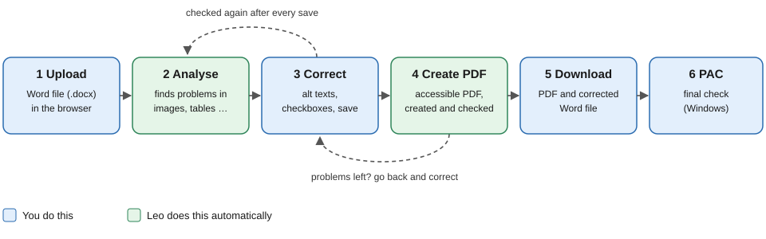

# Leo – User Guide

[Deutsch](INSTRUCTION.md) · **English**

*Leo – **L**eichte **E**rstellung **O**hne Barrieren (easy creation without barriers)*

Leo turns your Word report (.docx) into an **accessible PDF** (PDF/UA).
You upload the report in the browser, add what only a human can know
(above all, descriptions for images), and get a checked PDF back.

All you need is a browser. Address: **<https://leo.example.org>**

> **Note:** Leo's interface is in German. In this guide, button and field names are
> given in German as they appear on screen, with an English translation in brackets.

---

## How it works

## What Leo can do

| Area | Leo detects … | … and fixes it like this |
|---|---|---|
| Images, graphics, charts | missing or meaningless alt texts (“Bild 3”, file name) | you type the text, take over the caption, or mark the image as “decorative” |
| Tables | first row not marked as header row | tick a checkbox |
| Document title | title missing | fill in the field |
| Language | main language missing | choose from a list (e.g. German – Austria) |
| Links | links without a description, mainly in the tables of contents | automatically from the link text |
| Headings | skipped level (e.g. level 4 after level 2) | tick a checkbox, the heading is moved to the correct level |
| Font colours | too little contrast against white | tick a checkbox, the colour is darkened slightly |
| Headers and footers, captions, bibliography, links to local files | quirks that would cause errors in the PDF | automatically during PDF export, the Word file stays unchanged |
| Finished PDF | violations of PDF/UA | check report (basic check + veraPDF) with an explanation for every item |

You also get the **corrected Word file** back, so you don't have to re-enter anything
when you make changes later.

## What Leo cannot do

| What | Why / what to do |
|---|---|
| **Edit text** (typos, paragraphs, layout) | Leo only changes accessibility settings. Change the text in Word and upload again. |
| **Write good alt texts** | Only a human knows whether a description makes sense. Leo only notices when one is missing or obviously meaningless. |
| **Repair the structure**: missing headings, bold text instead of headings, typed bullet points, empty paragraphs used as spacing | Leo shows these places as hints. Please fix them in Word using styles. |
| Convert **tables pasted as images** into real tables | Leo points them out. Insert them in Word as real tables. |
| Check **colours inside graphics** (diagrams, pasted charts) | Only text colours are checked. Recreate such graphics in the source file with darker colours. |
| Check **contrast on coloured backgrounds** | Only contrast against white is checked. Check text on coloured areas yourself. |
| Detect **passages in other languages** | Set the language of the passage in Word. |
| Judge the **reading order** | Check it yourself in the PDF or with PAC. |
| **Preview** EMF/WMF graphics, Word charts, SmartArt | Leo only shows the type of graphic. Use the caption and section to find it. |
| Read **old .doc files** or PDFs | Save as .docx in Word. |
| **Replace PAC** | You do the final check with PAC yourself. After Leo it is usually a formality. |
| **Layout exactly as in Word** | The PDF is created with LibreOffice. Small differences (line breaks, page count) are possible. |

---

## At a glance

1. **Log in**
2. **Upload the Word file**
3. Go through the tabs **Dokument** (Document), **Bilder** (Images), **Tabellen** (Tables)
   and **Struktur & Hinweise** (Structure & hints) and fix open items
4. **Änderungen speichern** (Save changes)
5. **PDF erzeugen und prüfen** (Create and check PDF)
6. **Download** the PDF (and, if needed, the corrected Word file)
7. Finally check the PDF with **PAC**

The overview at the top always shows how many items are still open. Red numbers must be
fixed, yellow ones are hints.

---

## 1. Log in

Enter your user name and password. You get your login details from the administrator.

- You only see **your own** reports.
- After **8 hours of inactivity** you are logged out automatically.
- After **5 wrong passwords** the user name is **locked for 5 minutes**.
- Forgot or want to change your password? Please contact the administrator.

At the top right you find **Abmelden** (Log out). Admins also see
**Benutzerverwaltung** (User management) there (see [For admins](#for-admins)).

## 2. Upload the Word file

Click **Datei auswählen (.docx)** (Choose file) or drag the file into the box.
Leo reads the report and then shows the overview.

- Only **.docx** is accepted (no old .doc files, no PDF).
  Convert old files in Word with *File → Save As → Word Document (.docx)*.
- The file stays on the server and is not passed on to third parties.
- Leo remembers the report you last worked on. If you reload the page or come back
  later, it is open again.
- **Andere Datei** (Other file, bar at the bottom) closes the report and brings back the upload.

> **Tip:** Fix structural problems (headings, lists, empty paragraphs) **in Word first**
> and only then upload. Leo cannot edit the text itself.

## 3. Tab “Dokument” (Document)

### Dokumenttitel (Document title)

The title is shown in the PDF viewer instead of the file name and is read out by screen
readers. Enter the proper report title, e.g. “Final Report Praxistest 2026”.

### Hauptsprache (Main language)

Usually **Deutsch (Österreich)** (German – Austria). The language determines the
pronunciation in screen readers. Please mark English quotations or sections separately in
Word (*Review → Language → Set Proofing Language*).

### Links

PAC complains about links without a description. This mainly affects the table of contents
and the lists of figures and tables. Leave the checkbox **„Fehlende Linkbeschreibungen
automatisch … ergänzen“** (Add missing link descriptions automatically) ticked – it is
already preselected.

### Schriftfarben (Font colours – contrast)

Text must stand out clearly from the white background (at least 4.5 : 1).
Leo lists colours that are too light, shows where they are used and suggests a darker
shade. Tick **„abdunkeln auf …“** (darken to …) to apply the suggestion.
The colour looks almost the same afterwards but is easier to read.

Coloured text **inside inserted graphics** (diagrams, charts as images) cannot be checked
by Leo. Please recreate such graphics in the source file with darker colours.

## 4. Tab “Bilder” (Images)

Every image needs either an **alt text** or the mark **dekorativ** (decorative).

For each image you see a preview, the caption, the section it is in, and its status:

| Status | Meaning |
|---|---|
| **Alternativtext fehlt** (alt text missing, red) | must be added |
| **nichtssagend** (meaningless, yellow) | e.g. “Bild 3” or the file name – please replace with a real description |
| **ok** (green) | done |
| **dekorativ** (decorative, grey) | skipped by screen readers |

**How to work on the images:**

- **Type an alt text:** briefly describe *what the image shows and why it is there*.
  One or two sentences are usually enough.
- **Bildunterschrift übernehmen** (Use caption): takes the caption (without “Abbildung 3:”)
  as alt text. A good starting point, but often too short.
- **Alle leeren Alternativtexte aus der Bildunterschrift füllen** (Fill all empty alt texts
  from the caption): does this for all images at once. Please review them afterwards.
- **dekorativ** (decorative): for purely ornamental elements (lines, background areas,
  decorative pictures). **Logos are not decorative** – they get a text like “Logo of …”.
- **nur offene Punkte zeigen** (show only open items): hides completed images. Untick it
  to see all of them.

**Good alt texts**

| Instead of | Better |
|---|---|
| “Image 1” | “Aerial view of the project area with measuring points marked along the river” |
| “Chart” | “Bar chart: visitor numbers 2020–2025, rising from 1,200 to 3,400” |
| “Logo” | “Logo of the Province of Styria” |

For charts, state the **key message**, not every number. If everything is already in the
text next to it, a reference is enough (“data see table 4”).

**Graphics with text:** Leo marks graphics that contain labels. Include these labels in
the alt text. If there is a lot of text, it is probably a **table pasted as an image** –
please insert it in Word as a real table.

## 5. Tab “Tabellen” (Tables)

In every table the **first row must be marked as the header row**, otherwise screen readers
do not recognise the column headings.

- For every table with column headings, tick **„erste Zeile ist Kopfzeile“**
  (first row is header row).
- For orientation, Leo shows the content of the first row and the section.
- Tables with **only one row** are usually layout tables. Better design them in Word
  without a table.

In Word you do this under *Table Properties → Row → “Repeat as header row at the top of
each page”*.

## 6. Tab “Struktur & Hinweise” (Structure & hints)

### Übersprungene Überschriftenebenen (Skipped heading levels)

Headings must not skip a level (e.g. level 4 directly after level 2).
Leo can move the affected headings to the correct level – one by one with a checkbox or
with **Alle korrigieren** (Correct all). This may change the chapter numbering; please check
it in the PDF afterwards.

### Hinweise (Hints)

Leo **cannot** fix these items itself. Please correct them in Word and upload the
report again:

| Hint | What to do in Word |
|---|---|
| No headings | Format chapter headings with the styles “Heading 1, 2, 3 …” |
| Bold paragraph looks like a heading | If it is a heading: use a “Heading” style |
| List typed by hand | Use the bullet or numbering function instead of typing “-” or “1.” |
| Several empty paragraphs in a row | Set spacing with “Spacing before/after” in the style |
| Link to a file on your own computer (`C:\Users\…`) | Remove the link (right-click → Remove Hyperlink) or replace it with a web address |
| Link shows the bare web address | A meaningful link text is better (not an error) |
| Graphic with a lot of text | Insert as a real Word table or as text |

Red hints are **errors** (Fehler), yellow ones **warnings** (Warnung), grey ones only
**notes** (Hinweis).

### Gliederung (Outline)

On the right you see all headings with their level (H1, H2, …). This lets you quickly
check whether the outline is right. This outline becomes the bookmarks in the PDF.

## 7. Saving

The bar at the bottom shows **Ungespeicherte Änderungen** (Unsaved changes) as soon as you
have changed something. Then click **Änderungen speichern** (Save changes). Leo writes the
corrections into the Word file and reads it in again straight away.

Clicking **PDF erzeugen und prüfen** (Create and check PDF) saves automatically first.
If you try to leave the page with unsaved changes, the browser asks you to confirm.

## 8. Tab “PDF & Download”

### Automatic adjustments

At the top, Leo lists what is adjusted **automatically** during PDF export
(e.g. captions, bibliography, links in headers and footers). You don't have to do anything
for this. The downloadable Word file is not affected.

### Bilder verlustfrei speichern (Save images lossless)

Normally images are stored in very good quality (JPEG). The checkbox
**„Bilder verlustfrei speichern“** improves quality further, especially for images with a
transparent background – but the file becomes considerably larger.
Only use it if the image quality is visibly not good enough.

### PDF erzeugen und prüfen (Create and check PDF)

Click **PDF erzeugen und prüfen**. For large reports this takes **1–2 minutes**. If several
people are working at the same time, it may take a little longer.

Then you see two checks:

1. **Basisprüfung** (Basic check) – Leo's own check (title, language, alt texts,
   headings, table headers, fonts, links …). Every item has a ✓ or ✗ with an explanation.
2. **veraPDF** – complete automated check against PDF/UA-1, on the same basis as PAC.
   Goal: **„konform“** (compliant).

If there are problems, go back to the relevant tab, fix them and create the PDF again.

### Download

| Button | What you get |
|---|---|
| **PDF herunterladen** (Download PDF) | the accessible PDF |
| **Korrigierte Word-Datei (.docx)** (Corrected Word file) | your report with all corrections from Leo (alt texts, header rows, colours …). Use this file for later changes so you don't have to re-enter anything. |
| **OpenDocument (.odt)** | the same version for LibreOffice |

## 9. Finally: check with PAC

Open the PDF in **PAC** (PDF Accessibility Checker, Windows) and submit the check result
together with the report. After Leo this should only be a formality.

What no software can check remains your job:

- Are the **alt texts meaningful**?
- Is the **reading order** correct?
- Are links labelled understandably?

---

## Frequently asked questions

**Do I have to re-enter everything after a change in Word?**
No, as long as you continue working in Word with the **corrected Word file** from Leo.
The alt texts and header rows are already in it.

**I don't see a preview for an image.**
There is no preview for certain formats (EMF/WMF, Word charts, shapes, SmartArt).
Leo then shows the type of graphic. Use the caption and section to find it.

**The PDF looks slightly different from Word.**
The PDF is created with LibreOffice. Small differences (line breaks, page count) are
possible. If they are very noticeable, please report this to the administrator.

**My session has expired.**
Log in again. Saved changes are kept, unsaved ones are lost.

**Error message when uploading.**
Check that it really is a .docx file and that it opens in Word.

---

## For admins

Under **Benutzerverwaltung** (User management, top right, address `/admin`) admins can:

- **Create users** – user name (letters, digits and `. _ - @`) and password
  (at least 12 characters). Checkbox for admin rights.
- **Passwort setzen** (Set password) – e.g. if someone has forgotten their password.
  That person's existing sessions are ended immediately.
- Grant or revoke **admin rights**.
- **Delete users.**

You cannot delete yourself or revoke your own admin rights, so there is always at least
one admin. Please share passwords securely (not in the same e-mail as the user name).
