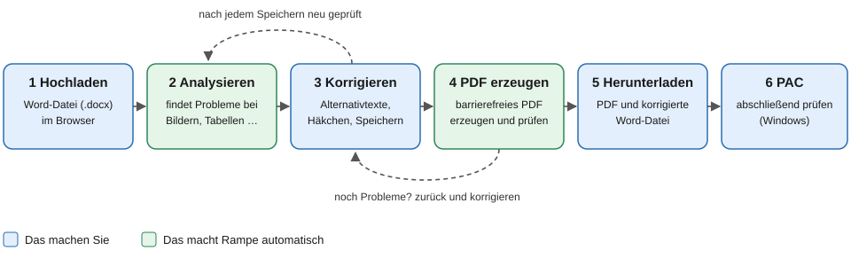

# Leo – Anleitung für Benutzerinnen und Benutzer

**Deutsch** · [English](INSTRUCTION.en.md)

*Leo – **L**eichte **E**rstellung **O**hne Barrieren*

Leo macht aus Ihrem Word-Bericht (.docx) ein **barrierefreies PDF** (PDF/UA).
Sie laden den Bericht im Browser hoch, ergänzen, was nur ein Mensch wissen kann
(vor allem Beschreibungen für Bilder), und bekommen ein geprüftes PDF zurück.

Sie brauchen dafür nur einen Browser. Adresse: **<https://leo.example.org>**

---

## So funktioniert es

## Was Leo kann

| Bereich | Leo erkennt … | … und behebt es so |
|---|---|---|
| Bilder, Grafiken, Diagramme | fehlende oder nichtssagende Alternativtexte („Bild 3“, Dateiname) | Sie tippen den Text ein, übernehmen die Bildunterschrift oder markieren das Bild als „dekorativ“ |
| Formeln | Formeln aus dem Formeleditor von Word brauchen einen Alternativtext | Leo schlägt die Linearform vor (z. B. `E=mc^2`), Sie können einen eigenen Text eintragen |
| Tabellen | erste Zeile nicht als Kopfzeile markiert | Häkchen setzen |
| Dokumenttitel | Titel fehlt | Feld ausfüllen |
| Sprache | Hauptsprache fehlt | Auswahl (z. B. Deutsch – Österreich) |
| Links | Links ohne Beschreibung, v. a. in Verzeichnissen | automatisch aus dem Linktext |
| Überschriften | übersprungene Ebene (z. B. Ebene 4 nach Ebene 2) | Häkchen, Überschrift kommt auf die richtige Ebene |
| Schriftfarben | zu wenig Kontrast zu Weiß | Häkchen, Farbe wird leicht abgedunkelt |
| Kopf- und Fußzeilen, Beschriftungen, Literaturverzeichnis, Links auf lokale Dateien | Eigenheiten, die im PDF zu Fehlern führen würden | automatisch beim PDF-Export, die Word-Datei bleibt unverändert |
| Fertiges PDF | Verstöße gegen PDF/UA | Prüfbericht (Basisprüfung + veraPDF) mit Erklärung zu jedem Punkt |

Außerdem bekommen Sie die **korrigierte Word-Datei** zurück. Damit müssen Sie bei
späteren Änderungen nichts neu eingeben.

## Was Leo nicht kann

| Was | Warum / was tun |
|---|---|
| **Text bearbeiten** (Tippfehler, Absätze, Layout) | Leo ändert nur Barrierefreiheits-Einstellungen. Text in Word ändern und neu hochladen. |
| **Gute Alternativtexte schreiben** | Ob eine Beschreibung sinnvoll ist, weiß nur ein Mensch. Leo merkt nur, ob einer fehlt oder offensichtlich nichtssagend ist. |
| **Struktur reparieren**: fehlende Überschriften, fett statt Überschrift, getippte Aufzählungen, leere Absätze als Abstand | Leo zeigt diese Stellen als Hinweis an. Bitte in Word mit den Formatvorlagen beheben. |
| **Tabellen als Bild** in echte Tabellen umwandeln | Leo weist darauf hin. In Word als echte Tabelle einfügen. |
| **Farben in Grafiken** prüfen (Schemata, eingefügte Diagramme) | Nur Schrift im Text wird geprüft. Grafiken in der Ursprungsdatei mit dunkleren Farben neu erstellen. |
| **Kontrast auf farbigem Hintergrund** prüfen | Geprüft wird nur gegen Weiß. Text auf farbigen Flächen selbst kontrollieren. |
| **Fremdsprachige Passagen** erkennen | In Word die Sprache der Passage eigens festlegen. |
| **Lesereihenfolge** beurteilen | Selbst im PDF bzw. mit PAC kontrollieren. |
| **Vorschau** für EMF/WMF-Grafiken, Word-Diagramme, SmartArt | Leo zeigt nur die Art der Grafik. An Bildunterschrift und Abschnitt orientieren. |
| **Alte .doc-Dateien** oder PDFs einlesen | In Word als .docx speichern. |
| **PAC ersetzen** | Den abschließenden Test mit PAC machen Sie selbst. Nach Leo ist er meist eine Formsache. |
| **Layout exakt wie in Word** | Das PDF wird mit LibreOffice erzeugt. Kleine Abweichungen (Zeilenumbrüche, Seitenzahl) sind möglich. |

---

## Auf einen Blick

1. **Anmelden**
2. **Word-Datei hochladen**
3. Die Reiter **Dokument**, **Bilder**, **Tabellen** und **Struktur & Hinweise** durchgehen
   und offene Punkte beheben
4. **Änderungen speichern**
5. **PDF erzeugen und prüfen**
6. PDF (und bei Bedarf die korrigierte Word-Datei) **herunterladen**
7. Das PDF abschließend mit **PAC** prüfen

Die Übersicht oben zeigt jederzeit, wie viele Punkte noch offen sind. Rote Zahlen
müssen erledigt werden, gelbe sind Hinweise.

---

## 1. Anmelden

Geben Sie Benutzername und Passwort ein. Die Zugangsdaten bekommen Sie von der
Administratorin bzw. dem Administrator.

- Sie sehen **nur Ihre eigenen** Berichte.
- Nach **8 Stunden ohne Aktivität** werden Sie automatisch abgemeldet.
- Nach **5 falschen Passwörtern** ist der Benutzername **5 Minuten gesperrt**.
- Passwort vergessen oder ändern? Bitte an die Administration wenden.

### Zwei-Faktor-Anmeldung (freiwillig)

Mit der Zwei-Faktor-Anmeldung braucht man außer dem Passwort einen Code, den eine App auf
Ihrem Handy alle 30 Sekunden neu erzeugt, z. B. Microsoft Authenticator, Google Authenticator
oder FreeOTP. Ein gestohlenes Passwort allein reicht dann nicht mehr.

1. Rechts oben auf Ihren **Namen** klicken, dann auf **Zwei-Faktor-Anmeldung** und **Einrichten**.
2. In der App ein Konto hinzufügen und den **QR-Code** scannen. Ohne Kamera: den angezeigten
   Schlüssel eintippen.
3. Den Code aus der App eingeben und **Aktivieren**.

Ab jetzt fragt Leo beim Anmelden nach dem Passwort nach dem **Code aus der Authenticator-App**.
Jeder Code gilt nur einmal. Kommt die Meldung „schon verwendet“, warten Sie auf den nächsten
Code. Ausschalten können Sie die Zwei-Faktor-Anmeldung an derselben Stelle mit einem gültigen
Code. **Handy verloren oder gewechselt?** Die Administration setzt sie zurück.

### Das Menü oben

| Wo | Was |
|---|---|
| links | **Leo** – führt zurück zur Startseite |
| Mitte | **Bericht** (die Prüfung); Admins sehen zusätzlich **Benutzer** und **Protokoll** (siehe [Für Admins](#für-admins)) |
| rechts | **Darstellung**: wechselt bei jedem Klick zwischen **Automatisch** (wie im Betriebssystem eingestellt), **Hell** und **Dunkel**. Die Wahl merkt sich der Browser. |
| ganz rechts | Ihr **Name**: klappt ein Menü auf mit **Zwei-Faktor-Anmeldung** (zeigt „ein“ oder „aus“) und **Abmelden** |

Das Menü lässt sich auch mit der Tastatur bedienen: Mit der Tab-Taste zum Namen, Eingabetaste
öffnet, **Esc** schließt.

## 2. Word-Datei hochladen

Klicken Sie auf **Datei auswählen (.docx)** oder ziehen Sie die Datei in das Feld.
Leo liest den Bericht ein und zeigt danach die Übersicht.

- Nur **.docx** wird angenommen (keine alten .doc-Dateien, kein PDF).
  Alte Dateien in Word mit *Datei → Speichern unter → Word-Dokument (.docx)* umwandeln.
- Die Datei bleibt auf dem Server und wird nicht an Dritte weitergegeben.
- Leo merkt sich den zuletzt bearbeiteten Bericht. Wenn Sie die Seite neu laden oder
  später wiederkommen, ist er wieder offen.
- **Andere Datei** (Leiste unten) schließt den Bericht und öffnet wieder das Hochladen.

> **Tipp:** Beheben Sie Strukturprobleme (Überschriften, Aufzählungen, leere Absätze)
> am besten **zuerst in Word** und laden Sie erst dann hoch. Leo kann den Text selbst
> nicht bearbeiten.

## 3. Reiter „Dokument“

### Dokumenttitel

Der Titel erscheint im PDF-Fenster statt des Dateinamens und wird von Screenreadern
vorgelesen. Tragen Sie den richtigen Berichtstitel ein, z. B.
„Abschlussbericht Praxistest 2026“.

### Hauptsprache

Meist **Deutsch (Österreich)**. Die Sprache bestimmt die Aussprache im Screenreader.
Englische Zitate oder Abschnitte bitte in Word eigens als Englisch markieren
(*Überprüfen → Sprache → Sprache für die Korrekturhilfen festlegen*).

### Links

Links ohne Beschreibung bemängelt PAC. Das betrifft vor allem Inhalts-, Abbildungs- und
Tabellenverzeichnis. Lassen Sie das Häkchen **„Fehlende Linkbeschreibungen automatisch
ergänzen“** gesetzt – es ist schon vorausgewählt.

### Schriftfarben (Kontrast)

Text muss sich deutlich vom weißen Hintergrund abheben (mindestens 4,5 : 1).
Leo listet zu helle Farben auf, zeigt, wo sie vorkommen, und schlägt einen
dunkleren Farbton vor. Mit dem Häkchen **„abdunkeln auf …“** übernehmen Sie den Vorschlag.
Die Farbe sieht danach fast gleich aus, ist aber besser lesbar.

Farbige Schrift **in eingefügten Grafiken** (Schemata, Diagramme als Bild) kann Leo
nicht prüfen. Solche Grafiken bitte in der Ursprungsdatei mit dunkleren Farben neu erstellen.

## 4. Reiter „Bilder“ (bzw. „Bilder & Formeln“)

Jedes Bild braucht entweder einen **Alternativtext** oder die Markierung **dekorativ**.

Zu jedem Bild sehen Sie eine Vorschau, die Bildunterschrift, den Abschnitt, in dem es
steht, und den Status:

| Status | Bedeutung |
|---|---|
| **Alternativtext fehlt** (rot) | muss ergänzt werden |
| **nichtssagend** (gelb) | z. B. „Bild 3“ oder der Dateiname – bitte durch eine echte Beschreibung ersetzen |
| **ok** (grün) | erledigt |
| **dekorativ** (grau) | wird vom Screenreader übersprungen |

**So bearbeiten Sie die Bilder:**

- **Alternativtext eintippen:** Beschreiben Sie kurz, *was das Bild zeigt und
  wozu es da ist*. Ein bis zwei Sätze reichen meist.
- **Bildunterschrift übernehmen:** übernimmt die Bildunterschrift (ohne „Abbildung 3:“)
  als Alternativtext. Gut als Ausgangspunkt, oft aber zu knapp.
- **Alle leeren Alternativtexte aus der Bildunterschrift füllen:** macht das für alle
  Bilder auf einmal. Danach bitte kurz durchsehen.
- **dekorativ:** für reine Zierelemente (Linien, Hintergrundflächen, Schmuckbilder).
  **Logos sind nicht dekorativ** – sie bekommen einen Text wie „Logo der …“.
- **nur offene Punkte zeigen:** blendet erledigte Bilder aus. Häkchen entfernen, um alle
  zu sehen.

**Gute Alternativtexte**

| Statt | Besser |
|---|---|
| „Bild 1“ | „Luftbild des Projektgebiets mit eingezeichneten Messstellen entlang des Flusses“ |
| „Diagramm“ | „Balkendiagramm: Besucherzahlen 2020–2025, Anstieg von 1.200 auf 3.400“ |
| „Logo“ | „Logo des Landes Steiermark“ |

Bei Diagrammen die **Kernaussage** nennen, nicht jede Zahl. Steht alles schon im Text
daneben, genügt ein Verweis („Daten siehe Tabelle 4“).

**Grafiken mit Text:** Leo kennzeichnet Grafiken, die Beschriftungen enthalten.
Nehmen Sie diese Beschriftungen in den Alternativtext auf. Bei sehr viel Text ist es
vermutlich eine **Tabelle als Bild** – diese bitte in Word als echte Tabelle einfügen.

### Formeln

Enthält der Bericht Formeln aus dem Formeleditor von Word, heißt der Reiter
**Bilder & Formeln**, und unter den Bildern steht der Abschnitt **Formeln**. Jede Formel
braucht im PDF einen Alternativtext, den der Screenreader vorliest.

- Ohne Eingabe verwendet Leo die **Linearform**, wie Word sie unter „Linear“ zeigt,
  z. B. `E=mc^2`. Damit ist das PDF in Ordnung.
- Besser verständlich ist oft ein **gesprochener Text**, z. B. „E gleich m mal c Quadrat“.
  Bei langen Formeln lohnt sich das besonders.
- **Linearform übernehmen** setzt den Vorschlag wieder ein.
- Ihr Text wird in der Word-Datei gespeichert. Ändern Sie die Formel später in Word, fragt
  Leo neu.

## 5. Reiter „Tabellen“

Bei jeder Tabelle muss die **erste Zeile als Kopfzeile** markiert sein, sonst erkennt
der Screenreader die Spaltenüberschriften nicht.

- Setzen Sie bei jeder Tabelle mit Spaltenüberschriften das Häkchen
  **„erste Zeile ist Kopfzeile“**.
- Zur Orientierung zeigt Leo den Inhalt der ersten Zeile und den Abschnitt.
- Tabellen mit **nur einer Zeile** sind meist Layout-Tabellen. Besser in Word ohne
  Tabelle gestalten.

In Word geht das übrigens unter *Tabelleneigenschaften → Zeile → „Gleiche Kopfzeile auf
jeder Seite wiederholen“*.

## 6. Reiter „Struktur & Hinweise“

### Übersprungene Überschriftenebenen

Überschriften dürfen keine Ebene auslassen (z. B. Ebene 4 direkt nach Ebene 2).
Leo kann die betroffenen Überschriften auf die richtige Ebene setzen – einzeln per
Häkchen oder mit **Alle korrigieren**. Dabei kann sich die Nummerierung der Kapitel
ändern; bitte danach im PDF kontrollieren.

### Hinweise

Diese Punkte kann Leo **nicht** selbst beheben. Bitte in Word korrigieren und den
Bericht neu hochladen:

| Hinweis | Was tun in Word |
|---|---|
| Keine Überschriften | Kapitelüberschriften mit den Formatvorlagen „Überschrift 1, 2, 3 …“ formatieren |
| Fett gesetzter Absatz sieht aus wie eine Überschrift | Wenn es eine Überschrift ist: Formatvorlage „Überschrift“ verwenden |
| Aufzählung von Hand getippt | Aufzählungs- bzw. Nummerierungsfunktion verwenden statt „-“ oder „1.“ zu tippen |
| Mehrere leere Absätze hintereinander | Abstände über „Abstand vor/nach“ in der Formatvorlage einstellen |
| Link auf eine Datei am eigenen Rechner (`C:\Users\…`) | Link entfernen (Rechtsklick → Link entfernen) oder durch eine Webadresse ersetzen |
| Link zeigt die nackte Webadresse | Besser einen sprechenden Linktext verwenden (kein Fehler) |
| Grafik mit sehr viel Text | Als echte Word-Tabelle bzw. als Text einfügen |

Rot markierte Hinweise sind **Fehler**, gelbe **Warnungen**, graue nur **Hinweise**.

### Gliederung

Rechts sehen Sie alle Überschriften mit ihrer Ebene (H1, H2, …). So prüfen Sie schnell,
ob die Gliederung stimmt. Diese Gliederung wird im PDF zu den Lesezeichen.

## 7. Speichern

Die Leiste unten zeigt **Ungespeicherte Änderungen**, sobald Sie etwas geändert haben.
Klicken Sie dann auf **Änderungen speichern**. Leo schreibt die Korrekturen in die
Word-Datei und liest sie sofort neu ein.

Beim Klick auf **PDF erzeugen und prüfen** wird automatisch vorher gespeichert.
Wenn Sie die Seite mit ungespeicherten Änderungen verlassen wollen, fragt der Browser nach.

## 8. Reiter „PDF & Download“

### Automatische Anpassungen

Oben listet Leo auf, was beim PDF-Export **automatisch** angepasst wird
(z. B. Beschriftungen, Literaturverzeichnis, Links in Kopf- und Fußzeilen). Sie müssen
dafür nichts tun. Die herunterladbare Word-Datei bleibt davon unberührt.

### Bilder verlustfrei speichern

Normalerweise werden Bilder in sehr guter Qualität (JPEG) gespeichert. Mit dem Häkchen
**„Bilder verlustfrei speichern“** wird die Qualität noch besser, vor allem bei Bildern
mit transparentem Hintergrund – die Datei wird aber deutlich größer.
Nur verwenden, wenn die Bildqualität sichtbar nicht reicht.

### PDF erzeugen und prüfen

Klicken Sie auf **PDF erzeugen und prüfen**. Bei großen Berichten dauert das
**1–2 Minuten**. Arbeiten mehrere Personen gleichzeitig, kann es etwas länger dauern.

Danach sehen Sie zwei Prüfungen:

1. **Basisprüfung** – Leos eigene Prüfung (Titel, Sprache, Alternativtexte,
   Überschriften, Tabellenköpfe, Schriften, Links …). Jeder Punkt hat ein ✓ oder ✗
   mit Erklärung.
2. **veraPDF** – vollständige maschinelle Prüfung nach PDF/UA-1, auf derselben Grundlage
   wie PAC. Ziel: **„konform“**.

Gibt es Probleme, gehen Sie zurück in den passenden Reiter, beheben sie und erzeugen das
PDF erneut.

### Herunterladen

| Knopf | Was Sie bekommen |
|---|---|
| **PDF herunterladen** | das barrierefreie PDF |
| **Korrigierte Word-Datei (.docx)** | Ihr Bericht mit allen Korrekturen aus Leo (Alternativtexte, Kopfzeilen, Farben …). Verwenden Sie diese Datei für spätere Änderungen, dann müssen Sie nicht alles neu eingeben. |
| **OpenDocument (.odt)** | dieselbe Fassung für LibreOffice |

### Bericht löschen

Ihre Berichte werden **automatisch gelöscht**: 30 Tage nach der letzten Nutzung, ältere
Berichte schon einen Tag, nachdem Sie einen neuen hochgeladen haben. Das Datum steht in der
Übersicht oben. Mit **Bericht jetzt löschen** (ganz unten im Reiter „PDF & Download“)
entfernen Sie alles sofort vom Server. Laden Sie vorher herunter, was Sie brauchen. Mit der
korrigierten Word-Datei können Sie jederzeit neu beginnen.

## 9. Abschließend: Prüfung mit PAC

Öffnen Sie das PDF in **PAC** (PDF Accessibility Checker, Windows) und übermitteln Sie das
Prüfergebnis zusammen mit dem Bericht. Nach Leo sollte das nur noch eine Formsache sein.

Was keine Software prüfen kann, bleibt bei Ihnen:

- Sind die **Alternativtexte sinnvoll**?
- Stimmt die **Lesereihenfolge**?
- Sind Links verständlich beschriftet?

---

## Häufige Fragen

**Muss ich nach einer Änderung in Word wieder alles neu eingeben?**
Nein, wenn Sie in Word mit der **korrigierten Word-Datei** aus Leo weiterarbeiten.
Die Alternativtexte und Kopfzeilen stecken dann schon darin.

**Ich sehe bei einem Bild keine Vorschau.**
Für bestimmte Formate (EMF/WMF, Word-Diagramme, Formen, SmartArt) gibt es keine Vorschau.
Leo zeigt dann die Art der Grafik an. Orientieren Sie sich an Bildunterschrift und Abschnitt.

**Das PDF sieht etwas anders aus als in Word.**
Das PDF wird mit LibreOffice erzeugt. Kleine Abweichungen (Zeilenumbrüche, Seitenzahl)
sind möglich. Fallen sie stark auf, melden Sie das bitte an die Administration.

**Mein Bericht ist weg.**
Berichte werden 30 Tage nach der letzten Nutzung gelöscht, ältere schon einen Tag nach dem
Hochladen eines neuen. Laden Sie die korrigierte Word-Datei hoch, dann ist alles wieder da.

**Meine Sitzung ist abgelaufen.**
Neu anmelden. Gespeicherte Änderungen bleiben erhalten, ungespeicherte gehen verloren.

**Fehlermeldung beim Hochladen.**
Prüfen Sie, ob es wirklich eine .docx-Datei ist und ob sie sich in Word öffnen lässt.

---

## Für Admins

Unter **Benutzer** im Menü oben (Adresse `/admin`) können Admins:

- **Benutzer anlegen** – Benutzername (Buchstaben, Ziffern und `. _ - @`) und Passwort
  (mindestens 12 Zeichen). Häkchen für Admin-Rechte.
- **Passwort setzen** – z. B. wenn jemand das Passwort vergessen hat. Bestehende
  Anmeldungen dieser Person werden sofort beendet.
- **Admin-Rechte** vergeben oder entziehen.
- **Zwei-Faktor zurücksetzen** – wenn jemand das Handy verloren hat. Die Person meldet sich
  danach nur mit Passwort an und kann die App neu einrichten.
- **Benutzer löschen.** Seine Berichte werden mitgelöscht.

Unter **Protokoll** im Menü oben (Adresse `/protokoll`) sehen Admins, wer wann was getan hat:
Anmeldungen (auch fehlgeschlagene), Benutzerverwaltung, Zwei-Faktor, Berichte hochgeladen,
erzeugt, heruntergeladen und gelöscht. Oben stehen Zahlen für den gewählten Zeitraum, darunter
die Einträge. Filtern lässt sich nach Suchbegriff, **Zeitraum**, **Aktion** und „nur
Fehlschläge“. Dateinamen und Inhalte der Berichte stehen nicht darin. Einträge werden nach
90 Tagen gelöscht.

Sich selbst löschen oder die eigenen Admin-Rechte entziehen geht nicht, so bleibt immer
mindestens ein Admin. Teilen Sie Passwörter bitte auf sicherem Weg mit (nicht im selben
E-Mail wie den Benutzernamen).
